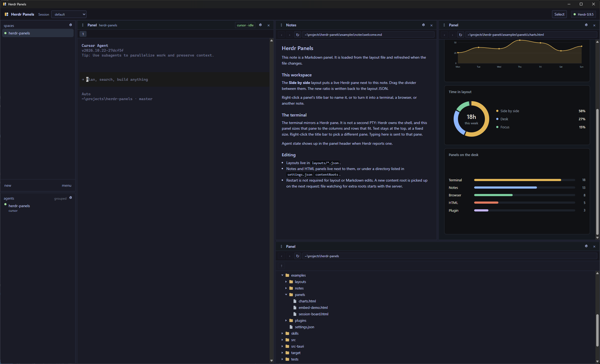

# Herdr Panels

A desk for a running [Herdr](https://herdr.dev) session. Live panes sit beside notes, browsers, HTML, and views you install. Drag a panel's grip onto the side of another panel to place it there, or onto the middle to swap. Right-click a title bar to name the panel or change what it shows. Each Herdr session has its own desk, and edits are saved as you make them.

An agent can do that arranging for you: open a URL, a note, an HTML page, or a plugin, then place the panels. The instructions it should follow are in [skills/herdr-panels/SKILL.md](skills/herdr-panels/SKILL.md).



## Download

Prebuilt programs are on the [latest release](https://github.com/justengel/herdr-panels/releases/latest). Each archive contains `herdr-panels` (the server and the commands) and `herdr-panels-desktop` (the window). Node and Rust are not required, and there is no system installer.

| System | Archive |
| --- | --- |
| Linux x64 | `linux-x64.tar.gz` |
| Windows x64 | `windows-x64.zip` |
| macOS Apple Silicon | `macos-arm64.tar.gz` |
| macOS Intel | `macos-x64.tar.gz` |

The Linux build is for an Ubuntu 22.04 or newer desktop. It uses the system OpenSSL, Wayland client, and WebKitGTK libraries. Install the web view once if it is not already there:

```sh
sudo apt install libwebkit2gtk-4.1-0
```

Unpack the archive and run `./herdr-panels` from that folder. The desktop program is beside it, so this opens the window and listens on http://127.0.0.1:4737. The first start writes the viewer token and the example layouts into the config directory. A browser tab at that address shows the same desk. `herdr-panels server` starts the server and leaves the window closed.

`herdr-panels update` downloads the latest GitHub release for this system and replaces `herdr-panels`. When `herdr-panels-desktop` is in the same folder, that program is replaced from the same release. A viewer that is already running is stopped and started again on the same address. An open desktop window is closed and opened again so it loads the new page. A copy that is still in a cargo target directory is left unchanged. The command is on `herdr-panels`, not on the desktop program. Run `herdr-panels install-launcher` again after an update so the application menu keeps the new program path.

`herdr-panels` with no arguments starts the viewer and the desktop window. When that viewer is already running, the same command opens the window and exits. It checks the address in `server.json`, the same address `herdr-panels status` uses. If that address belongs to another program, the message says it is not a herdr-panels viewer. `herdr-panels server` still only starts the viewer. A second server on the same address does not start.

Closing the window does not stop the viewer that `herdr-panels` started. The desk stays available to a browser tab and to `herdr-panels panel`. Stop that viewer by ending the `herdr-panels` process. The exited desktop window is waited on, so it does not stay behind as a zombie. `herdr-panels-desktop` is different: when nothing is listening, it starts a viewer inside the desktop process, and closing that window stops the viewer it started. The application menu runs `herdr-panels` so the viewer stays up.

### Linux application menu

On a desktop session, install the menu entry from the program you want the menu to run:

```sh
herdr-panels install-launcher
```

This writes `$XDG_DATA_HOME/applications/herdr-panels.desktop`, or `~/.local/share/applications/herdr-panels.desktop` when `XDG_DATA_HOME` is unset. `Exec` is the absolute path of that `herdr-panels` program. `Icon` is the name `herdr-panels`. The icons are installed under `icons/hicolor` at 48, 128, and 256 pixels, plus the SVG in `scalable`. `StartupWMClass` is `herdr-panels-desktop`, which is the class the window uses. The command then runs `update-desktop-database` on the applications directory when that program is installed (`desktop-file-utils`).

The menu's starting spinner ends when a window of that class appears. `gtk-launch` itself returns as soon as the process has been started. The window shows after the desktop program creates its web view.

On Windows, unpack the zip and run `herdr-panels.exe`. The window uses the WebView2 already on Windows 10 and 11.

On macOS, unpack the archive and run `./herdr-panels`. The window uses the system web view. The archive is unsigned, so the first launch can be blocked. Right-click the program and choose Open, or in that folder run `xattr -cr .` once. An Apple developer account is not required. `herdr-panels update` clears that download mark on the programs it replaces.

With `herdr-panels` on `PATH`, Herdr can start that same program. The manifest in this repository does not compile anything:

```sh
herdr plugin install justengel/herdr-panels
```

The action is **Open Herdr Panels**. That command runs until you stop the viewer. View plugins loaded inside the desk are a separate mechanism, described under [Design mode](#design-mode).

Building from this repository is next. The release notes start at [CHANGELOG.md](CHANGELOG.md).

## Install and run

These steps build from source. Requirements: Rust, Node.js, and a running Herdr (`herdr`, or `herdr server` for a headless session). The commands are the same on Windows, macOS, and Linux.

```sh
cd web
npm install
npm run build
cd ..
cargo install --path .
```

`npm install` fetches the packages for the page. `npm run build` writes that page to `web/dist`. Both the browser and the desktop window show that page, so this build is done once. `cargo build --release` packages that page and `examples/` into the program. It stops if `web/dist/index.html` is missing. `cargo install --path .` puts `herdr-panels` on your PATH. That program is the server. A debug build can compile before the page exists; it then serves a short setup page unless `web/dist` is still on disk.

```sh
herdr-panels
```

This listens on http://127.0.0.1:4737 and opens a browser tab. Opening that address loads the page with its token, so you do not paste one. The first start copies the bundled examples into the config directory and writes `auth-token` there. A release program carries those examples itself. A build made in this checkout still prefers the `examples/` directory on disk, so edits there are what get copied.

The desktop window is optional:

```sh
cargo install --path src-tauri
```

Run that from the repository root. After it is installed, `herdr-panels` opens the native window instead of a browser tab. `herdr-panels desktop` opens that window directly. The window uses the operating system's web view. Windows uses the WebView2 already on the machine, and macOS uses the system web view. The Linux build needs WebKitGTK. A browser tab can still open http://127.0.0.1:4737 while the window is open. They share the Herdr session and that session's desk.

`herdr-panels server` starts the server and leaves the window and the browser closed. `herdr-panels server --open` opens a browser tab even when the desktop program is installed. Running `herdr-panels` again, with the viewer already up, opens the desktop window and exits. A second `herdr-panels server` on the same address does not start. From this checkout, before `herdr-panels` is on your PATH, `cargo run --release` does the same thing. `herdr-panels install-launcher` writes the Linux menu entry described under [Linux application menu](#linux-application-menu).

UI development, server flags, and the short layout commands are in [Setup](#setup).

## Architecture

```text
browser (React)
    |  REST + WebSocket, 127.0.0.1 only
Axum server
    |  newline-delimited JSON
Herdr API socket
    Windows: \\.\pipe\<config>\herdr.sock
    Unix:    the socket path itself
```

Herdr's stable control plane is the JSON socket API (`herdr api schema`), not the private length-prefixed client protocol. That private protocol can attach a PTY directly, but it is tied to one Herdr build. This app stays on the public API:

- `session.snapshot` lists workspaces, panes, agents, and pane geometry.
- `pane.read` with `format: ansi` returns the visible screen. Herdr 0.8 does not bump `revision` on output, so the server compares the screen text.
- `pane.send_text` and `pane.send_keys` deliver typing. There is no public output subscription, so an open terminal polls about every 150ms and pushes a new screen only when the text changes.
- Agent status comes from the snapshot (`idle`, `working`, `blocked`, `done`, `unknown`).

Dragging a divider writes the layout file. Splitting a terminal can also call `pane.split`, which opens a real Herdr pane and binds the new panel to it. Other panel types stay in this page. A shell panel keeps a fixed glyph size, pins the grid to the top, and tells Herdr the column and row count that fit the panel.

### Directory layout

```text
src/                 Rust server: socket client, layouts, content, proxy, websockets
assets/              HTML bridge injected into custom panels
examples/            Seed layouts, a note, an iframe page, an HTML panel, and a view plugin
web/                 React workspace
web/src/components   Layout engine, design mode, and the panel types
```

### Panel types

| type | What it shows |
| --- | --- |
| `herdr` | xterm.js mirror of a pane. `paneId` is optional; the header can bind one. |
| `iframe` | A browser frame. `proxy: true` reverse-proxies a loopback `http(s)` origin so it can be framed. |
| `markdown` | A local `.md` file, sanitized in the browser and refreshed when the file changes. |
| `html` | A local HTML file or an inline snippet. A bridge script exposes `window.herdrPanels`. |
| `plugin` | An installed view. The id names a directory under `<config>/plugins` that contains `plugin.json` and its own HTML. |
| `explorer` | A file list. An empty path lists the open workspace folders. |
| `file` | The plain text of a local file. |
| `files` | The spaces list: open Herdr workspaces, with a status dot. |
| `agents` | Agents in the session, grouped under the spaces list. |
| `blank` | An empty panel. |
| `chat` | An older local transcript. It still loads. A Herdr pane is the place to run an agent. |

### Panels

Every panel title bar shows that panel's name, and the close button sits at the far right.

- Drag the grip onto another panel. The panel follows the pointer, and a preview opens on the left, right, top, or bottom to show where it will land. The middle of the panel swaps the two.
- Right-click the title bar to name the panel. That name is how an agent addresses it.
- The same menu keeps the open file or URL and chooses a viewer for it: Markdown, Browser, Text, or Files. Terminal, Spaces, and Agents sit in their own section. A plugin is another viewer when it says which files it opens, or its own panel when it does not.
- Add a panel to the right or below. **Add panel** in the top bar splits a new terminal to the right of the selected one. Those new panels stay local until Design mode is asked to split the Herdr pane too.
- × closes the panel. The last panel stays.
- Typing `exit` in a shell closes that panel after Herdr drops the pane. A panel pointed at a pane that was already gone stays open so you can pick another pane.
- Resizing a shell panel changes its columns and rows. The glyphs stay the same size and the text stays at the top. Keystrokes follow Herdr's live screen, including the cursor.

### Keyboard

The desk can be driven from the keyboard. **Keys** in the top bar lists the shortcuts, and so does Prefix+? (the prefix defaults to Ctrl+B, the same one Herdr uses).

Prefix+H, J, K, and L still move between Herdr panes. Focusing a desk panel is one shortcut with two chords by default: Alt+Shift+Arrow and Prefix+Arrow. Prefix+Alt+Arrow swaps that panel with the neighbor in that direction. The focused panel has an accent bar on its title. Prefix+Tab cycles panels. Prefix+F fills the screen with the focused panel, or shows the whole desk. Prefix+Z and Prefix+Shift+Z go back and forward in the selected panel, the same as the address bar buttons. Prefix+T reopens the last closed panel, and repeats for older ones. Those closed panels stay in this window, up to 30, and a restart clears them. The prefix works from a plugin, an HTML panel, and a browser panel. Ctrl+Z is left for the program inside a panel. Inside a terminal, Prefix+Z still belongs to Herdr.

Prefix+Alt+N and Prefix+Alt+P move between spaces. Prefix+Shift+1 through 9 jumps to a space. Prefix+Alt+Period and Prefix+Alt+Comma move between agents, and Prefix+Alt+1 through 9 jumps to an agent. Prefix+G focuses the address bar. Prefix+A opens the Agents list, and Prefix+B or Prefix+W opens the Spaces list. Up and Down move in those lists. Enter opens the highlighted row. Prefix+Alt+W closes the focused panel. The last panel stays.

Keybinds, then Panels, lists every desk shortcut. Change records the keys you press. An action with more than one chord stores them as a comma-separated list. Reset puts the usual chords back. Those shortcuts belong to this window.

The prefix reaches a plugin, an HTML panel, and a browser panel. Ctrl+B inside a plugin frame reaches the desk, the same way it does in a terminal. Clicking one of those panels selects it even when the page inside keeps the click. Other keys stay with the page. Opening and resizing stay on the pointer, or on `herdr-panels panel` for an agent.

### Design mode

The Design button turns the workspace into an editor:

- Click a panel to select it. In a Markdown note or a custom HTML panel, click a heading, paragraph, or other element to select that component.
- Change the selection into a terminal, browser, Markdown file, HTML view, or plugin, and edit its path, URL, pane, or plugin id.
- Split right or split down, then drag the new divider. Close removes that panel and keeps the other side. The last panel stays.
- Add the selection to a chat when a chat panel is already open.
- When the selected panel is a Herdr terminal, **Split the Herdr pane too** opens a new pane in the daemon and attaches it to the new panel.

`examples/layouts/desk.json` starts with a terminal, a note, and an HTML panel. The first run copies example layouts, notes, and the plugin guide. It does not install a plugin. `herdr-panels plugin install --example` installs the Welcome sample. Copy `examples/plugins/welcome` to start a plugin of your own, and follow `examples/plugins/README.md`. That guide is also copied to `<config>/plugins/README.md`. A plugin is a directory:

```text
<config>/plugins/<id>/plugin.json
<config>/plugins/<id>/index.html
```

`plugin.json` has `id`, `title`, and `entry` (default `index.html`). `views` says which addresses a plugin can open, so it can sit beside Markdown or Text for that file. Leave `views` out and the plugin is its own panel. `addressBar` shows that bar, lets `modify` change it, or uses `replace` so the plugin can draw its own. The panel gear can show or hide the bar. An optional `permissions` list can ask for `herdr:read`, `herdr:control`, `panels:read`, `panels:control`, `files:read`, or `links:open`. `files:read` also needs a `files` list of absolute paths or directories. Those paths use the system's own separators. Install asks before granting those, unless you pass `--yes`. `herdr-panels plugin list` prints each plugin's permissions. A plugin with no `permissions` is unchanged. Install the sample with `herdr-panels plugin install --example`, or install another directory with `herdr-panels plugin install <directory>`. The open desk reads that directory again and shows a new plugin, or drops one that was removed, without restarting the viewer. `herdr-panels plugin uninstall <id>` deletes that plugin directory. An open panel that was showing it stays until you close the panel. `examples/plugins/desk-sample` asks for `panels:read` and `panels:control`, opens `https://example.com` as a browser panel, and does not draw the rest of the desk. `links:open` lets a plugin call `openExternal` for an `http` or `https` address. A clicked link, including `target="_blank"`, does not need that permission. In the desktop window the address opens in the system browser. In a browser tab it opens a new tab. `herdr-panels panel open` with an `http` or `https` address still adds a browser panel. That is a new panel, not a tab, and no HTML `target` selects one. The page loads a plugin at `/plugins/<id>`. See `examples/plugins/README.md`.

### Agents

An agent on this machine can drive the focused space of the current session's desk over HTTP. The calls need the viewer token, which the `herdr-panels` commands attach on their own. The page does not have to perform the edit: a split, close, resize, or panel change is saved and pushed to a connected browser. Reads work with the page closed. A connected page adds the live DOM, computed CSS, and the current terminal screen.

```text
GET  /api/agent
GET  /api/agent/workspace
POST /api/agent/split     {"panelId","direction":"right"|"down","title?","panel?","herdr?":true}
POST /api/agent/close     {"panelId"}
POST /api/agent/resize    {"panelId","ratio"}
POST /api/agent/update    {"panelId","title?","panel?"}
POST /api/agent/move      {"panelId","target","place":"swap"|"right"|"below"}
POST /api/agent/zoom      {"panelId":null}
POST /api/agent/visit     {"panelId"}
GET  /api/agent/spaces
GET  /api/agent/panels/{id}?selector=h2&text=workspace
POST /api/agent/panels/{id}/write   {"text":"echo hi","keys":["enter"]}
POST /api/agent/panels/{id}/select  {"selector":"h2","text":"workspace"}
POST /api/agent/say       {"to":"chat"|"*","from":"planner","text":"look at the note"}
```

`panelId`, `{id}`, and `say.to` accept a panel id or its unique name, compared without case. `*` still means every chat. `visit` shows a panel from any space over the one that is open. The reply names that panel and its space. A name that is not on any space is `panel was not found`, and two different panels with the same name are refused. `spaces` lists every saved space, which is how to find a title that `workspace` does not show. `workspace` stays the focused space. `viewer` is true when a page is connected. The overlay appears in that page. A page built before the visit ignores the message. [The skill](skills/herdr-panels/SKILL.md) is the procedure an agent should follow for these calls.

`ratio` is that panel's share of the nearest divider, from 0.12 to 0.88. `herdr: true` also calls Herdr `pane.split` and binds the new terminal. `move` swaps two panels or places one to the right of or below the other. `say` appends to a chat panel; `to` is a panel id, a unique panel name, or `*` for every chat. A chat linked to a pane also types the message into that pane. `write` types into a terminal panel. `select` outlines the match in the open page. Browser HTML that is loopback or served from `/content` can be fetched directly; a same-origin frame, or a custom HTML panel, also returns the live elements and computed style. The proxy still refuses anything that is not loopback.

### Layout JSON

A layout is either a `split` (`direction` is `row` or `column`, `ratio` is the first child's share), a `grid` of weighted tracks and cells, or a `panel`. The desk for a session lives in `<config>/desks/<session>.json`: a revision, the pins, and one layout tree per space. Address-bar visibility, raw text, and a plugin's subject are fields on the panel in that tree. `herdr-panels panel` edits the focused space of the current session, including the pins that space shows. `<config>/layouts/<id>.json` is still a saved layout document. The id and the filename must match. `settings.json` stores `activeLayout` and optional `contentRoots`. Those directories, the open workspace folders, and pane directories are where a relative path is looked up. An absolute path can be any file this user can read. A relative path cannot contain `..`.

### Custom HTML bridge

Sandboxed panels cannot call the API directly. The injected script provides:

```js
await herdrPanels.listPanes()
await herdrPanels.status()
await herdrPanels.readPane("w1:p1")
await herdrPanels.sendText("w1:p1", "echo hi")
await herdrPanels.sendKeys("w1:p1", ["enter"])
await herdrPanels.focusPane("w1:p1")
```

`sendText`, `sendKeys`, and `focusPane` run only when that panel's JSON sets `"control": true`. Listing panes and reading a pane stay available. `examples/panels/session-board.html` is a working panel; its Send button needs that flag.

A plugin with `herdr:read`, `herdr:control`, `panels:read`, `panels:control`, or `links:open` gets this same bridge, injected into its entry page. `links:open` allows `openExternal(url)` for an `http` or `https` address. In the desktop window that opens the system browser. In a browser tab it opens a new tab. A clicked link does the same thing without the permission. `openPanel` with an `http` or `https` address, which needs `panels:control`, adds a browser panel instead. That is a new panel, not a tab. The frame still does not receive the viewer token, and it still cannot call `/api`. The server checks the declaration. `herdr:read` allows `listPanes`, `status`, and `readPane`. `herdr:control` allows `sendText`, `sendKeys`, `focusPane`, and `scrollPane`, and only on a panel whose layout sets `"control": true`. `focusPane` switches the desk to that pane's workspace, shows it in a terminal panel, and brings that panel to the front. When control is off, the error says to turn on control in the design bar. `scrollPane` moves that Herdr pane up or down by 1 to 200 lines, and the pane has to be open in the viewer. `panels:read` allows `listPanels`. `panels:control` allows `openPanel`, `updatePanel`, `closePanel`, `movePanel`, `resizePanel`, `fillPanel`, `showDesk`, `visitPanel`, and `setZoom`, the same edits as `herdr-panels panel`. `fillPanel` fills the screen with one panel that is already on this space. `visitPanel` shows a panel from any space over this one, and Back leaves it without changing the other space. `showDesk` brings the desk back. `setZoom` sets the desktop window zoom to the nearest browser step, from 25% to 500%. A browser tab ignores it. Those calls do not type into a pane, and they cannot set `"control": true`. An HTML panel's bridge does not perform the desk calls. `files:read` is separate: the page asks with `postMessage` (`source: "hwp-plugin"`, `type: "watch"` or `"unwatch"`, and a `path` inside the declared `files` list). The server sends `{ source: "hwp-host", type: "file", path, content, mtime }` and sends it again when the file changes. `examples/plugins/checkin-report` is that kind of plugin.

### Security

The server refuses any non-loopback bind. The first start writes one viewer token to `auth-token` in the config directory and does not print it. On Unix that file is mode `0600`. `/api` and `/ws` require the token. The page receives it in its HTML, sends `Authorization: Bearer` on API calls, and puts it on the websocket URL as `token`. Ordinary HTTP requests ignore a `token` query parameter. `herdr-panels token rotate` replaces the file. `herdr-panels token set <value>` stores a token you created, from 32 to 256 characters. Restart the viewer and reload the page afterward. `HERDR_PANELS_TOKEN` overrides the file for that process and is not written to disk.

A browser `Origin`, when one is present, must be this viewer's own port on `localhost`, `127.0.0.1`, or `::1`, or the Vite dev server on port 5173. The shell page is not served to a `null` origin. Plugin files load in the viewer's own frames without the token, because those files are the installed plugin. Content files and the loopback proxy require the token. The page mints a separate pass for each content or proxy frame, and the frame address carries that pass so its own images and scripts still load. The pass is not the viewer token. It covers one content directory, or one loopback proxy target, and it cannot call the API. `/api/frame` does not follow a redirect that leaves the site it was asked about.

The iframe proxy accepts only `localhost`, `127.0.0.1`, and `::1`, and it does not forward `Cookie`, `Authorization`, or `Set-Cookie`. Plugin frames and proxied frames are sandboxed. A remote page keeps its own origin so its cookies still work, and it cannot navigate the viewer window. An HTML panel can type into a pane only when `"control": true`. A plugin can type, focus, or scroll a pane only when it declared `herdr:control` and that same flag is set on its panel. It can list or change panels on the desk, or set the desktop window zoom, only when it declared `panels:read` or `panels:control`. It can read a local file only when it declared `files:read` and the path stays inside the `files` list. The server checks that path on every read. It can ask the host to open an address only when it declared `links:open`, and the address has to be `http` or `https`. A click on a link is not that call: the desktop window opens `http` and `https` in the system browser, and a browser tab opens a new tab. Other schemes are refused.

## Setup

Install and the desktop window are at the top. Once `web/dist` exists, this starts the viewer without opening a window:

```sh
herdr-panels server
```

From this checkout, `cargo run --release -- server` does the same thing.

In another terminal, for UI development:

```sh
cd web
npm install
npm run dev
```

Open http://127.0.0.1:5173. The Vite server proxies API, content, frame, plugin, proxy, and websocket traffic to port 4737. Start the viewer first so `auth-token` exists; Vite reads that file, or `HERDR_PANELS_TOKEN` when it is set.

`herdr-panels --open` and `cargo run -- --open` still start the server and open a browser tab.

The server is the long-running viewer. Layout changes are short commands against that process:

```sh
herdr-panels panel list
herdr-panels panel split Notes --direction right --kind html
herdr-panels panel close Board
herdr-panels panel resize Notes 0.4
herdr-panels panel move Notes --to Herdr --place below
herdr-panels panel update Chat --title Shell --kind herdr
herdr-panels panel zoom Notes
herdr-panels panel visit
herdr-panels panel visit google
herdr-panels plugin list
herdr-panels plugin install --example
herdr-panels plugin install <directory>
herdr-panels plugin install <directory> --yes
herdr-panels plugin uninstall <id>
herdr-panels update
herdr-panels install-launcher
herdr-panels token rotate
herdr-panels token set <value>
```

`panel` names a viewer panel. A Herdr pane stays a Herdr pane: use `herdr pane` for the daemon, and point a terminal panel at it.

### Server flags

```text
herdr-panels server
--config <dir>           Use this directory instead of the default config dir
--herdr-session <name>   Attach to a named Herdr session
--herdr-socket <path>    Attach to a specific API socket
--host 127.0.0.1         Loopback address (the default)
--port 4737              HTTP port
--open                   Open a browser tab
```

Default config directory:

- Windows: `%APPDATA%\herdr-panels`
- macOS and Linux: `$XDG_CONFIG_HOME/herdr-panels` or `~/.config/herdr-panels`

The first launch copies the bundled examples into that directory when it has no layouts. `HERDR_PANELS_CONFIG` selects that directory when `--config` is omitted, which is how `npm run dev` finds the same place as the viewer. `HERDR_PANELS_TOKEN` overrides `auth-token` for each process that has it set. Herdr's own socket is discovered from `HERDR_SOCKET_PATH`, then `HERDR_SESSION` / `--herdr-session`, then the default session socket printed by `herdr status`.

The example side-by-side layout targets pane `w1:p1`. If that pane is not in the session, right-click the terminal's title bar and choose another pane. The choice is saved into the layout file.

### Named session

```sh
herdr --session demo server
herdr --session demo workspace create --label demo
cargo run -- server --herdr-session demo
```

## Desktop shell

`src-tauri` opens this same viewer in a native window. How to start it is in [Install and run](#install-and-run). The window class is `herdr-panels-desktop`. Closing the window leaves the viewer running when `herdr-panels` started it. Ctrl or Cmd with the mouse wheel, plus, minus, or 0 scales the desktop panels together, from 25% to 500%. The session bar stays the same size, and a terminal keeps its place in its history. A browser tab uses the browser's own zoom. A browser panel whose address is `http` or `https` is a child webview laid on that panel's content rectangle, so the site is its own top-level page. Moving a divider sends the new rectangle to the webview. A right-click menu stays on screen and the webview shifts out from under it. The settings dialog, design mode, and a panel drag hide the webview so those controls can take the pointer. Element selection stays on the page and runs inside it. A normal browser tab still uses an iframe.

## Development checks

```sh
cd web
npm install
npm test
npm run build
cd ..
cargo test
cargo build --release
```

`cargo test` covers layout parsing, path confinement, key mapping, the loopback proxy, and snapshot geometry. It does not need a running Herdr. A live Herdr is required to exercise a terminal pane. `cargo build --release` includes the page built by `npm run build`.

## License

[MIT](LICENSE)
