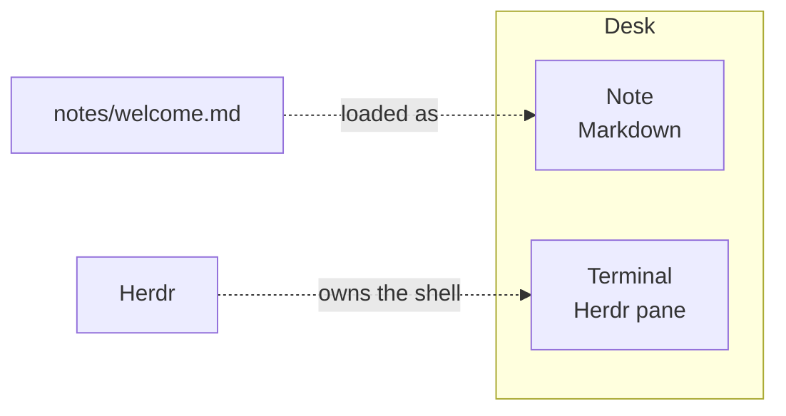

# Flowchart

A `mermaid` fence in a note is drawn as a diagram. This one is a flowchart.



The paragraph under the diagram stays text. A fence in another language stays a code block.

```text
notes/flowchart.md
```
